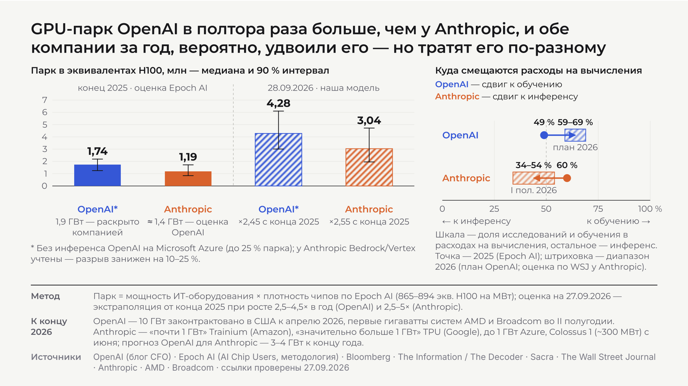

# Сколько GPU у OpenAI и Anthropic и как они делятся между обучением и инференсом

Ответ на вопрос CTO по состоянию на **27 сентября 2026**. Все источники открыты и проверены 27.09.2026; в отчёте источник или способ расчёта стоит рядом с каждым числом.

| Материал | Где |
|---|---|
| **Слайд для CTO** (один слайд, PDF) | [`gpu_fleet_review_out/results/gpu_fleet_slide_cto.pdf`](gpu_fleet_review_out/results/gpu_fleet_slide_cto.pdf) |
| **Отчёт с источником у каждого числа** (HTML, открыть в браузере) | [`gpu_fleet_review_out/results/report_cto.html`](gpu_fleet_review_out/results/report_cto.html) |
| Подробный документ с приложениями (контракты, коэффициенты, методология, реестр источников) | [`gpu_fleet_review_out/draft_v2.md`](gpu_fleet_review_out/draft_v2.md) |
| Ноутбук, который воспроизводит все числа | [`gpu_fleet_review.ipynb`](gpu_fleet_review.ipynb) |

[](gpu_fleet_review_out/results/gpu_fleet_slide_cto.pdf)

## Ответ коротко

**Число чипов ни одна компания не публикует, поэтому считаем в мощности и в эквивалентах H100.** На конец 2025 года OpenAI располагала ≈ 1,9 ГВт мощности (раскрыто компанией). По оценке Epoch AI это 1,74 млн эквивалентов H100 (90 % интервал 1,25–2,19 млн). Anthropic — ≈ 1,4 ГВт по оценке OpenAI и 1,19 млн эквивалентов H100 (0,84–1,72 млн) по модели Epoch AI. В штуках это ≈ 1,14 млн и ≈ 1,25 млн ускорителей: у Anthropic чипов больше при меньшей мощности, потому что около 0,8 млн из них — Trainium2, каждый равен двум третям H100.

**На 27 сентября 2026 наша оценка:** OpenAI ≈ 4,27 млн эквивалентов H100 (90 % прогонов: 3,00–6,08 млн), то есть ≈ 4,6 ГВт мощности оборудования; Anthropic ≈ 3,03 млн (1,95–4,70 млн), ≈ 3,3 ГВт. Это экстраполяция оценок Epoch AI по темпу роста (2,5–4,5 раза в год у OpenAI, 2,5–5 у Anthropic), 200 000 прогонов Монте‑Карло, а не отчётность компаний.

**Деление между обучением и инференсом известно только в деньгах.** В 2025 году OpenAI тратила на обучение и исследования и на инференс примерно поровну (49 % / 51 %), Anthropic — 60 % / 40 % в пользу обучения. На 2026 год — сценарии: у OpenAI по её плановым цифрам ($32 млрд на обучение при бюджете $50 млрд) доля обучения растёт до 59–69 %, хотя план, вероятно, недооценивает инференс; у Anthropic по квартальным данным The Wall Street Journal за первое полугодие 2026 доля обучения падает до 34–54 %.

| | OpenAI | Anthropic | Откуда |
|---|---|---|---|
| Мощность, конец 2025 | ≈ 1,9 ГВт | ≈ 1,4 ГВт | блог OpenAI (CFO, 18.01.2026); меморандум OpenAI инвесторам (Bloomberg, 09.04.2026) |
| Эквиваленты H100, конец 2025 | 1,74 млн (1,25–2,19) | 1,19 млн (0,84–1,72) | Epoch AI, AI Chip Users (09.09.2026); модели воспроизведены в ноутбуке с точностью лучше 1 % |
| Физических ускорителей, конец 2025 | ≈ 1,14 млн | ≈ 1,25 млн | наш расчёт по составу парков Epoch AI |
| Эквиваленты H100 на 27.09.2026 | 4,27 млн (3,00–6,08) | 3,03 млн (1,95–4,70) | наша модель; рост в 2,45 и 2,55 раза с конца 2025 |
| Мощность оборудования на 27.09.2026 | ≈ 4,6 ГВт (3,3–6,6) | ≈ 3,3 ГВт (2,1–5,1) | наша модель |
| Доля обучения в расходах на вычисления, 2024 | 71 % | не раскрыто | Epoch AI по данным The Information |
| Доля обучения, 2025 | 49 % | 60 % | Epoch AI, The Information, Sacra |
| Доля обучения, 2026 (сценарии) | 59–69 % (план) | 34–54 % (первое полугодие) | наш расчёт по плановым цифрам OpenAI и квартальным данным WSJ |

Что нужно помнить: точку сравнения дают только данные на конец 2025 года, всё после — модель с интервалами; 1,4 ГВт Anthropic — оценка конкурента; инференс на площадках партнёров учтён у Anthropic и не учтён у OpenAI, поэтому сравнение занижает OpenAI на 10–25 %; «обучение» в деньгах — весь бюджет исследований, а не только финальные прогоны.

На слайде столбики на дату слайда подписаны 28.09.2026 (4,28 и 3,04 млн); расчёт в репозитории зафиксирован на 27.09.2026 (4,27 и 3,03 млн). Разница в один день расчёта, на выводы не влияет.

## Как получены числа

1. **Парк на конец 2025** — модели Epoch AI (OpenAI: раскрытые 1,9 ГВт → эквиваленты H100 через состав чипов Microsoft с лагом развёртывания; Anthropic: 1,0–1,9 ГВт → доля Trainium2) переписаны на NumPy и воспроизводят медианы Epoch с точностью 0,2 % и 0,4 %.
2. **Оценка на дату слайда** — парк на конец 2025, умноженный на годовой темп роста в степени прошедшей доли года; парк и темп разыгрываются 200 000 раз; выводятся медиана, 50 % и 90 % интервалы; перевод в гигаватты по плотности парка (894 и 865 эквивалентов H100 на мегаватт) и новых поставок (945 и 950).
3. **Проверка по площадкам** — каталог ЦОД Epoch AI (Абилин, Rainier, Colossus 1) как нижняя граница; чувствительность к прочтению «мощность здания, а не оборудования» и к краям диапазона темпа.
4. **Физические ускорители** — IT‑мощность, делённая на среднюю мощность чипа при составе парка Epoch AI; контрольные точки Colossus 1 и Абилин сходятся с каталогом Epoch в пределах 0,1 %.
5. **Сплит обучение/инференс** — только в деньгах, на базисе облачных расходов: 2024–2025 по Epoch AI и утечкам The Information/Sacra; 2026 — сценарии по плану OpenAI ($32 млрд обучение, инференс $14,1–22 млрд) и по квартальным данным WSJ для Anthropic (маржа инференса 60–72 %).

Все расчёты детерминированы (фиксированное начальное значение генератора). Реестр из 63 источников с URL, датами и статусами — [`gpu_fleet_review_out/data/sources_2026-09-27.csv`](gpu_fleet_review_out/data/sources_2026-09-27.csv).

## Состав репозитория

```
README.md
requirements.txt                      зависимости для воспроизведения
gpu_fleet_review.ipynb                самодостаточный ноутбук: данные встроены, выполняется одной командой
notebook_src/                         исходники ноутбука: cells/ (ячейки), inputs/ (встраиваемые данные), build.py (сборка)
gpu_fleet_review_out/
  results/
    gpu_fleet_slide_cto.pdf           слайд для CTO (и .png для предпросмотра)
    report_cto.html                   отчёт для CTO с источником у каждого числа
    slide_brief/  slide_brief.zip     пакет для дизайнера слайда: задание, все числа и источники, референс раскладки
    slide.html  slide_data.json  slide_spec.md    черновой макет слайда, его данные и спецификация
    nowcast_*.json|md|png  chips_*.json  split_*.json|md|png   результаты расчётов
    changes_vs_original.md            что изменено относительно исходного документа
  data/
    sources_2026-09-27.csv            реестр источников (63 записи, все с датой доступа)
    coefficients.csv  split_inputs.csv  changelog_v2.md  epoch/ (CSV Epoch AI с SHA-256)
  draft_original.md  draft_v2.md      исходный документ и его исправленная версия с приложениями
  calc_nowcast.py  calc_chips.py  calc_split.py   расчётные скрипты (запускаются и отдельно)
```

## Воспроизведение

```bash
pip install -r requirements.txt          # Python 3.9 или новее
jupyter nbconvert --to notebook --execute --inplace gpu_fleet_review.ipynb
```

Ноутбук пересоздаёт папку `gpu_fleet_review_out/`. Дата слайда зафиксирована (`NOWCAST_DATE=2026-09-27`), при необходимости переопределяется переменной окружения; без сети используются встроенные копии CSV Epoch AI. Сборка ноутбука из исходников ячеек: `python3 notebook_src/build.py`.
